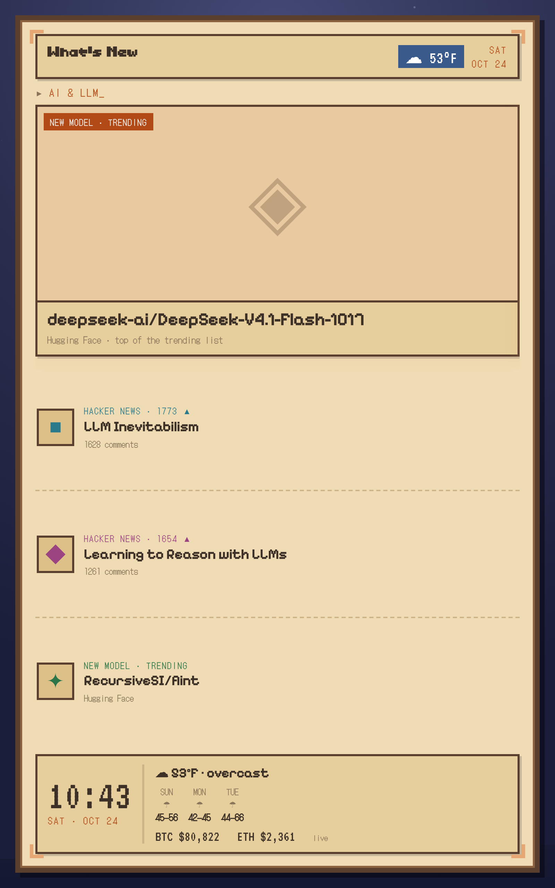
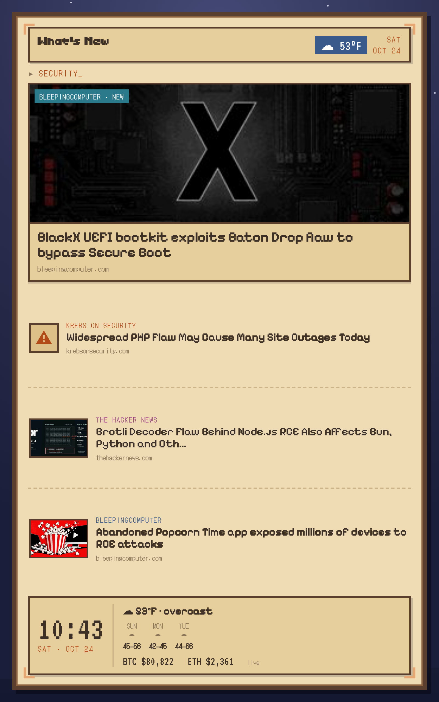
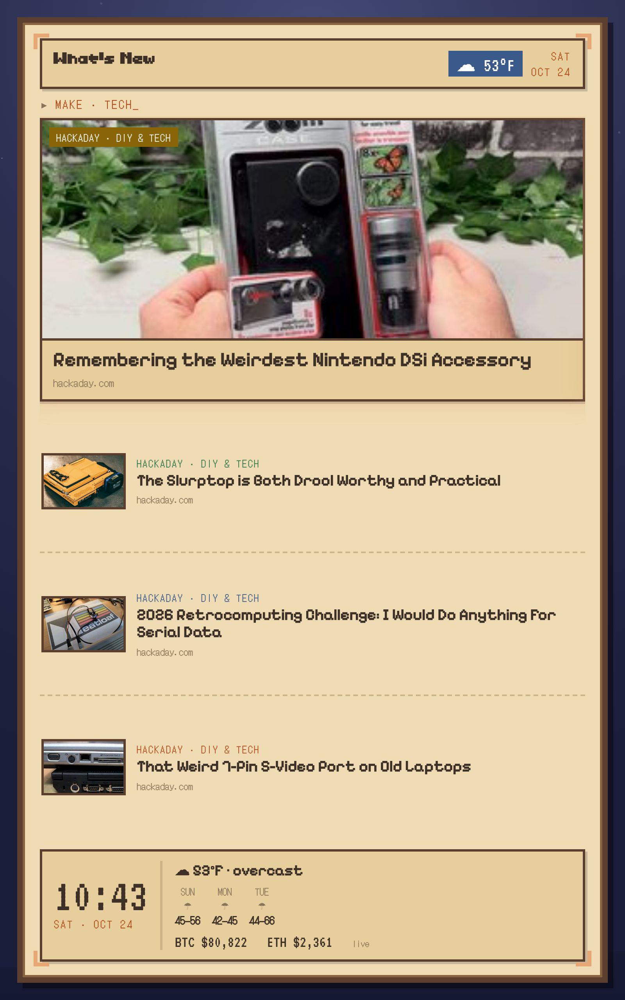

# Times Frame Dashboard


An animated, cozy **pixel-journal info dashboard** for the [Divoom Times Frame](https://divoom.com/products/times-frame) — a 10.1" 800×1280 transparent desk display. It renders a themed, rotating "What's New in my world" board (AI, security, gaming, making, crypto, weather) as a looping video and pushes it to the frame over the LAN.

The device is treated as a dumb terminal. Everything smart — fetching feeds, laying out the pages, the animation — happens off-device in a small generator. The frame just plays the result.

<p>



</p>

## How it works

```
feeds (RSS/JSON)  ─►  generator  ─►  800×1280 looping MP4  ─►  Times Frame
  HN, HF, Krebs,      fetch → lay    (pixel journal, page-     (LAN HTTP :9000,
  Hackaday, crypto,   out HTML →      turns + ambient motion)   plays on loop)
  weather, …          render video
```

1. **Fetch** — pull the latest items from each topic's feed (`src/fetch.py`).
2. **Build** — compose a pixel-art journal page (parchment on a night sky, PetProject-style) from the data, one spread per topic (`src/build.py` + `src/template.html`). Live data is baked straight into the layout.
3. **Render** — drive a deterministic animation (page-turns, twinkling stars, hero glow) frame-by-frame with headless Chromium and encode to H.264 (`src/render.py`).
4. **Push** — upload the MP4 to the frame's photo library over the local API and select it; the frame loops it (`src/push.py`).

A small always-on box (a Raspberry Pi) runs this loop every few minutes so the data stays fresh and the frame recovers after a reboot.

## Why a video?

The Times Frame can't fetch our images from the internet (its cloud proxy only trusts Divoom's own CDN — see [`docs/API.md`](docs/API.md)), and a *saved* dial can't be pointed at a custom data source. The one thing it does well is **play a looping local video**. So the whole dashboard — custom fonts, parchment, page-turns, ambient motion — is rendered to a video off-device and played as a photo-library clip. This sidesteps every device limitation at once, and gives us total creative freedom: anything renderable in a browser becomes the display.

## Design

- **Aesthetic:** a cozy retro-game "travel journal" — warm parchment panels with pixel-art borders and corner brackets, floating on a dark night sky, so the transparent panel reads as depth. Fonts: Toriko (title), Pixelify Sans (headlines), DotGothic16 (labels), VT323 (numerals).
- **Pages:** themed spreads (AI & LLM, Security, Make/Tech, …) rotate on their own, with a persistent console (clock, weather + forecast, crypto) pinned at the bottom.
- **Config-driven topics:** add or remove a topic by editing a list — the layout flexes to fit.

## Status

Working end to end on hardware (Times Frame, hardware 510 / firmware 510175):

- [x] Device LAN API mapped and the whole render → push pipeline proven
- [x] Looping video playback confirmed (ambient motion + page-turns)
- [x] Live feeds, article images, hero cards, 30fps
- [x] Device clock/weather overlay suppressed for a clean canvas

## Roadmap

- [ ] **The keeper** — run the loop on a Raspberry Pi (fetch → render → push every few minutes, reboot recovery)
- [ ] **LLM summaries** — a local model (Ollama) turns each article into a readable one-liner, so items are self-contained on a non-interactive screen
- [ ] **Themed pages with unique animations** — crypto (live charts, fear/greed gauge, ticker tape), PC gaming / emulation, gaming leaks & rumors
- [ ] **Broken-up floating cards** — separate the UI into floating panels so the animated sky shows through (lean into the transparent panel)
- [ ] **A mascot** — a little pixel creature wandering the margins, reacting to the feed
- [ ] **Cloud option** — host the generator + a shareable web version (Azure), with the Pi as a thin render/push relay

## Running it (dev)

```bash
pip install playwright pillow && playwright install chromium   # one-time
# ffmpeg required on PATH
python3 src/fetch.py          # -> data.json (+ img/)
python3 src/build.py          # data.json -> journal.html
python3 src/render.py         # journal.html -> journal.mp4
python3 src/push.py <frame-ip>  # upload + display on the frame
```

Find the frame's IP from your router, or via Divoom's LAN-membership probe:
`curl https://app.divoom-gz.com/Device/ReturnSameLANDevice`.

## Credits

- Device API behavior documented in [`docs/API.md`](docs/API.md), building on the community reverse-engineering effort (notably [dragonpaw/divoom](https://github.com/dragonpaw/divoom) and Divoom's own [DivoomDevelop](https://github.com/DivoomDevelop) tooling).
- Fonts are third-party; see [`fonts/README.md`](fonts/README.md) for sources and licenses.
- Built by **Rectangular** with **Claude**.
